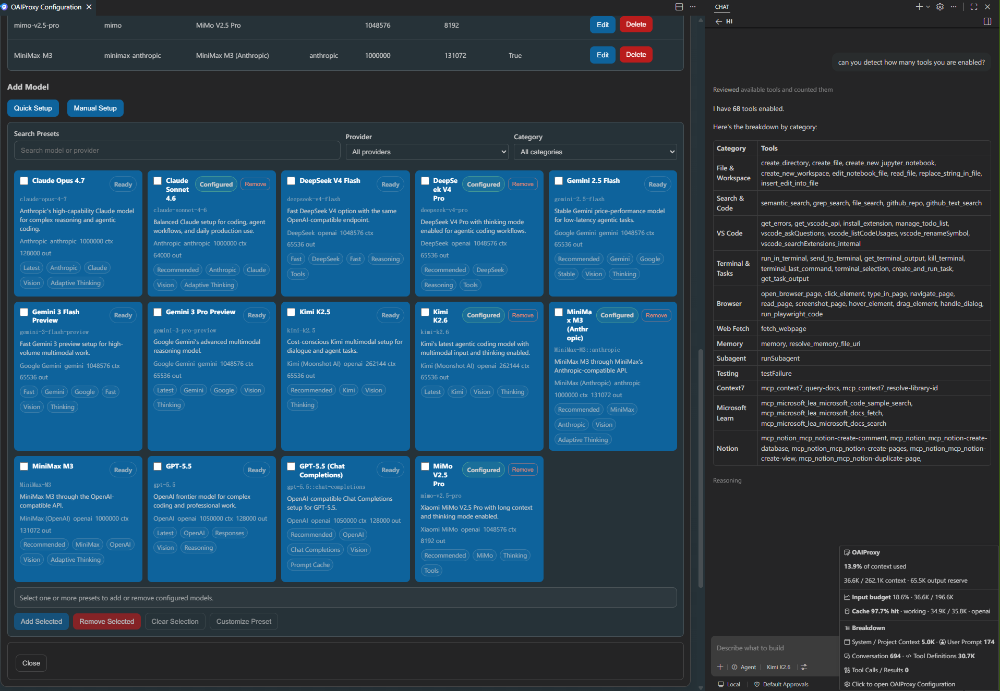

<div align="center">


# OAIProxy

**自维护的 VS Code 扩展，用于在 GitHub Copilot Chat 中使用 Azure Foundry/OpenAI/Ollama/Anthropic/Gemini API 供应商，并内置 Azure Foundry、OpenAI、TokenRouter、Anthropic、Fireworks、Kimi、DeepSeek、Z.AI GLM、小米 MiMo、MiniMax 预设** 🔥

[English](README.md) | 简体中文

</div>

[](https://github.com/lqdflying/OAIProxy/blob/main/LICENSE)



## 特性
- **多 API 支持**：Azure Foundry/OpenAI/Ollama/Anthropic/Gemini API，并内置 Azure Foundry 直连卡片及 TokenRouter、Fireworks、Kimi、DeepSeek、Z.AI GLM、小米 MiMo、MiniMax、ModelScope、SiliconFlow 等预设
- **视觉模型**：完整支持图像理解能力
- **视觉桥接**：在纯文本模型中使用图像 — OAIProxy 通过配置的视觉模型自动描述图像，并采用 LRU 缓存
- **思维链标签支持**：在所有供应商（OpenAI、Ollama、Gemini、Anthropic）中无缝显示模型思维/推理模块
- **思维链力度控制**：模型选择器中 VS Code 内置的按模型 Thinking Effort 下拉菜单 — 实时自定义推理力度
- **高级配置**：灵活的对话请求选项，支持思维链/推理控制
- **多供应商管理**：同时配置多个供应商模型，自动管理各供应商 API 密钥
- **模型连接测试**：在 Model Management 中测试单个已配置模型，或最多并行运行四个测试，并使用模型真实保存的请求配置
- **供应商用量检查**：在独立的 Provider Usage Check 表格中查看 Fireworks 当月无服务器 token、DeepSeek/Kimi 余额、TokenRouter Management Key 账户余额、MiniMax token 套餐剩余额度，以及 OpenAI/Anthropic 当月费用用量；Z.AI 和小米 MiMo 在没有公开 API key 用量端点时会显示为暂不可用
- **同模型多配置**：为同一模型定义不同参数配置（如 GLM-4.6 开启/关闭思维链）
- **可视化配置界面**：直观的界面管理供应商和模型
- **自动重试**：处理 API 错误（429、500、502、503、504），支持指数退避
- **请求取消**：即时停止进行中的聊天请求 — 所有 API 模式均连接到 HTTP `AbortController`
- **Token 用量**：状态栏实时显示 token 计数和供应商 API 密钥管理
- **Git 集成**：使用 OpenAI/OpenAI Responses/Ollama/Anthropic 模型直接从源代码管理生成提交信息
- **导入/导出**：轻松分享和备份配置
- **工具优化**：对支持的流式工具调用优化 agent `read_file` 工具处理，避免对大文件读取小片段。
- **结构化日志**：基于文件的请求/调试日志，支持日志轮转和可配置级别（`off`/`debug`/`info`/`warn`/`error`）

## 环境要求
- VS Code 1.120.0 或更高版本。
- OpenAI 兼容供应商的 API 密钥。

## 快速开始
1. 安装 OAIProxy VSIX 包（`lqdflying.oaiproxy`）。
2. 打开 VS Code 设置，配置 `oaicopilot.baseUrl` 和 `oaicopilot.models`。
3. 打开 GitHub Copilot Chat 界面。
4. 点击模型选择器，选择 "Manage Models..."。
5. 选择 "OAIProxy" 供应商。
6. 输入你的 API 密钥——它将保存在本地。
7. 选择你想添加到模型选择器中的模型。

> 兼容性说明：OAIProxy 仍使用现有的 `oaicopilot.*` 设置键，因此已有 JSON 模型配置可以继续使用。由于扩展 ID 已改为 `lqdflying.oaiproxy`，VS Code 可能需要你在新扩展下重新输入一次 API Key。

> [!IMPORTANT]
> **在 VS Code 1.128+ 中使用 OAIProxy/BYOK 模型时，请配置辅助模型（utility model）。** VS Code 默认不会为 BYOK 配置辅助模型，因此 Agent 模式可能会提示：`No utility model is configured for 'copilot-utility-small' while the selected main agent model is BYOK.` 这是 VS Code 的模型路由提示，并不表示 Kimi K3 或 OAIProxy 请求失败。
>
> 请在用户 `settings.json` 中添加推荐选项：
>
> ```jsonc
> "chat.byokUtilityModelDefault": "copilot"
> ```
>
> - `"copilot"`（可使用 GitHub Copilot 辅助模型时推荐）：OAIProxy/Kimi K3 继续作为主 Agent 模型，由 Copilot 处理意图识别、聊天标题、摘要和提交信息等轻量后台任务。
> - `"mainAgent"`：当前选中的 OAIProxy/BYOK 主模型也会处理这些辅助任务。无法使用 Copilot 辅助模型时请选择此项；这会向模型供应商发送更多请求，速度可能更慢，费用也可能更高。
>
> 显式设置的 `chat.utilityModel` 或 `chat.utilitySmallModel` 会优先于此默认值。详情请参阅 [VS Code BYOK 辅助模型文档](https://code.visualstudio.com/updates/v1_128#_configure-the-default-utility-model-for-byok)。

### 配置示例

```json
"oaicopilot.baseUrl": "https://api-inference.modelscope.cn/v1",
"oaicopilot.models": [
    {
        "id": "Qwen/Qwen3-Coder-480B-A35B-Instruct",
        "owned_by": "modelscope",
        "context_length": 256000,
        "max_tokens": 8192
    }
]
```

## 配置界面

本扩展提供可视化配置界面，用于管理供应商、模型和 API 密钥，无需手动编辑 JSON 文件。可通过命令面板（`OAIProxy: Open Configuration UI`）打开，或点击 OAIProxy 状态栏项。

供应商管理表单将 Azure Foundry 排在首位，随后是现有供应商预设。请将占位 URL 替换为直连的 `https://<resource>.services.ai.azure.com/openai/v1`，并保存推理密钥；密钥保存为 `oaicopilot.apiKey.azure-foundry`，请求通过 `api-key` 验证。Quick Setup 提供 `Kimi-K2.6` 和 `DeepSeek-V4-Pro` 两张 Azure Foundry 卡片。

Quick Setup 提供使用 OpenAI API key 的 **GPT-6.1 Sol** 和使用 ChatGPT/Codex 登录的 **GPT-6.1 Sol (OAuth)** 两张卡片。两者使用模型 ID `gpt-6.1-sol` 和 `apiMode: "openai-responses"`，启用视觉和工具调用，并默认使用 `xhigh` 推理。Thinking Effort 可选 `low`、`medium`、`high`、`xhigh`、`max`，不支持 `none` 或 `minimal`。预设配置 1,050,000 token 上下文窗口和 128,000 token 输出额度；OpenAI 上游默认值为 `medium`，`xhigh` 是 OAIProxy 的预设选择。详见[官方模型规格](https://developers.openai.com/api/docs/models/gpt-6.1-sol)和 [Codex 可用性说明](https://learn.chatgpt.com/docs/models#gpt-6.1-sol)，OAuth 访问取决于账户、推出进度和工作区设置。

OAuth 卡片使用独立供应商 `openai-oauth` 和 `https://chatgpt.com/backend-api/codex`。在 **OpenAI OAuth (Codex)** 供应商行的 **Actions** 中选择 **Sign in**，完成设备码登录后添加卡片；凭据保存在 VS Code SecretStorage 中，并在请求前刷新。

**OpenAI Compatible**（`apiMode: "openai-compatible"`）用于只提供 OpenAI Chat Completions 的通用网关。把占位 base URL `https://YOUR-GATEWAY.example.com/v1` 换成你的网关地址（需要时包含 `/v1`）并保存密钥；OAIProxy 将其保存为 `oaicopilot.apiKey.openai-compatible`，并使用 `Authorization: Bearer` 认证。请求整形与 chathub 的 OpenAI 兼容供应商一致：只转发 `model`、`messages`、`stream`、`stream_options`、`max_tokens`、`reasoning_effort`、`stop`、`tools`、`tool_choice` 以及采样字段；网关需要其他字段时可以通过 `extra` 添加，`extra` 会合并进请求体。对 `gpt-6-astra*` 和 `gpt-6.1-sol*` 去掉 `temperature`、`top_p`、`frequency_penalty` 和 `presence_penalty`，与 chathub 对这些模型族的裁剪规则一致。`max_completion_tokens` 会以 `max_tokens` 发送，`reasoning_effort` 始终为顶层字段。启用 `prompt_cache` 时，OAIProxy 会根据模型、思考强度、工具选择与工具定义、所有 system/developer 消息以及首条 user 消息派生会话稳定的 `prompt_cache_key`。Quick Setup 提供一张卡片：**GPT-6 Astra**（默认 `xhigh` 推理），声明 258,000 token 的兼容上下文预算和 128,000 token 的输出额度。网关提供的其他模型可以通过 Manual Setup 添加，上面的请求整形规则同样适用于这些行。2026 年 10 月 30 日对一个 Codex 兼容网关的验证显示，该网关已不再提供 `gpt-5.5`（已于 2026 年 10 月 14 日从 ChatGPT 登录通道下线），因此不再提供 GPT-5.5 卡片。该供应商没有公开的用量/余额端点，因此用量检查会显示不可用原因。Responses 路由、`Session_id` 请求头、图像生成和视频透传不属于该供应商；Responses-only 网关请使用 `apiMode: "openai-responses"`。参见 `examples/openai-compatible.jsonc`。

Model Management 提供每个模型的 `Test` 操作和并行的 `Test all` 操作。每次测试都会通过模型保存的供应商、API 模式、自定义请求头和高级参数发送一条小型真实推理请求，因此可能产生少量供应商用量。

独立的 Provider Usage Check 表格会动态列出已配置且支持用量检查的供应商，并按余额、token、token 套餐或费用用量展示结果。Fireworks 账户发现和当月无服务器 token 检查复用普通 Fireworks API key。OpenAI 和 Anthropic 的用量/admin key 会与聊天 API key 分开保存。TokenRouter 使用单独的 Management Key，并通过 Management API self-wallet 端点显示账户余额。Z.AI 和小米 MiMo 条目会显示不可用原因，因为当前公开文档未提供 API key 用量或余额端点。

→ [完整配置指南](doc/configuration.zh-CN.md)

## 多 API 模式

支持八种 API 协议：`azure-foundry`（使用 `api-key` 的 Azure Foundry 直连 Chat Completions）、`openai`、`openai-compatible`（通用 OpenAI 兼容网关，按 chathub 的请求整形规则发送）、`litellm`、`openai-responses`、`ollama`、`anthropic` 和 `gemini`。通过 `apiMode` 参数为每个模型指定。

TokenRouter、Fireworks、Kimi、DeepSeek、Z.AI GLM 和小米 MiMo 使用现有 `openai` 模式，因为它们的托管 API 与 OpenAI 格式兼容。MiniMax 同时支持 `openai` 和 `anthropic` 模式；MiniMax 推荐在 M3 思维链和交错思维工作流中使用 Anthropic 兼容端点。

→ [完整多 API 指南](doc/configuration.zh-CN.md#多-api-模式)

## Azure Foundry

Azure Foundry 使用资源的 `/openai/v1` 直连端点，而不是 Azure API Management 网关。Kimi 卡片默认 `high` 推理，DeepSeek 卡片默认 `max` 推理。两者均支持工具调用，Kimi 还启用视觉能力。

Azure Foundry 自动且尽力执行模型 prompt caching。OAIProxy 不会为这两张卡片发送 `prompt_cache_key`、`prompt_cache_retention` 或 `thinking`。通过 `cache.usage` 日志及 `usage.prompt_tokens_details.cached_tokens` 验证实际命中。

## Fireworks AI

Fireworks 作为一级供应商使用 `https://api.fireworks.ai/inference/v1` 和完整模型 ID，例如 `accounts/fireworks/models/deepseek-v4-pro`、`accounts/fireworks/models/kimi-k2p7-code` 和 `accounts/fireworks/models/glm-5p2`。Quick Setup 中的 Fireworks 托管卡片与原始 DeepSeek、Kimi 和 Z.AI 卡片分别保留。

Fireworks 默认启用 prompt caching。OAIProxy 添加稳定的 `user` affinity 值以改善缓存路由，并从 OpenAI 兼容 usage 响应中读取缓存 token 遥测。Fireworks 用量检查通过公开账户 API 发现账户并报告当月无服务器输入/输出 token；HTTP 端点目前不提供计价费用总额。

## TokenRouter

TokenRouter 通过 `https://api.tokenrouter.com/v1` 提供 OpenAI 兼容接口。Quick Setup 卡片使用精确的网关模型 ID：`deepseek/deepseek-v4-pro-0813`、`qwen/qwen3.8-max`、`moonshotai/kimi-k3` 和 `z-ai/glm-5.3`；供应商密钥单独保存为 `oaicopilot.apiKey.tokenrouter`。TokenRouter 余额检查使用单独保存为 `oaicopilot.usageApiKey.tokenrouter` 的 Management Key，并调用 Management API wallet 端点。

## Z.AI GLM-5.2

模型 ID 使用 `glm-5.2`，Base URL 使用 Z.AI GLM Coding Plan 端点（`https://api.z.ai/api/coding/paas/v4`）。Z.AI 文档列出 GLM-5.2 为文本模型，支持 1,000,000 token 上下文窗口、131,072 最大输出 token、思维链/推理、reasoning effort 和工具调用。Quick Setup 预设会启用思维链，设置 `reasoning_effort: "max"`，并设置 `thinking.clear_thinking: false` 以在后续请求中保留返回的 reasoning 内容。

## MiniMax M3

模型 ID 使用 `MiniMax-M3`。MiniMax 的 M3 文档列出 1,000,000 token 上下文窗口、工具调用、代码/Agent 工作流、自适应思维链，以及原生图像/视频输入。OAIProxy 通过现有 MiniMax OpenAI 兼容预设（`https://api.minimax.io/v1`）和 MiniMax Anthropic 兼容预设（`https://api.minimax.io/anthropic`）支持 M3。

OpenAI 模式建议使用 `max_completion_tokens`、`thinking: { "type": "adaptive" }`，并设置 `extra.reasoning_split: true` 以分离流式思维内容。Anthropic 模式使用 `max_tokens` 和 `thinking: { "type": "adaptive" }`。为 M3 设置 `vision: true`，这样 OAIProxy 会直接转发图像和受支持的视频 `LanguageModelDataPart`，而不是把图像输入交给视觉桥接。

## 视觉桥接

在纯文本模型中使用图像。OAIProxy 通过配置的视觉能力模型自动描述图像，然后以文本形式转发，并采用 LRU 缓存（50 条，~500KB）。

→ [视觉桥接指南](doc/vision-bridge.zh-CN.md)

## 多供应商指南

同时配置多个供应商的模型。使用 `owned_by` 按供应商分组模型，自动按供应商管理 API 密钥，存储为 `oaicopilot.apiKey.<provider>`。

→ [多供应商指南](doc/configuration.zh-CN.md#多供应商指南)

## 同模型多配置

通过 `configId` 为同一模型 ID 定义多个配置（如 `glm-4.6::thinking` 和 `glm-4.6::no-thinking`），每个配置独立设置参数。

→ [多配置指南](doc/configuration.zh-CN.md#同模型多配置)

## 思维链力度控制

VS Code 1.120+ 在模型选择器中提供按模型的 Thinking Effort 下拉菜单。通过 `supports_reasoning_effort: true` 启用。DeepSeek 模型默认使用 `high`/`max`；Claude Sonnet 4.6 会自动识别并映射到 Anthropic `output_config.effort`。

→ [思维链力度指南](doc/thinking-effort.zh-CN.md)

## 自定义请求头

为每个模型供应商指定自定义 HTTP 请求头（API 版本控制、额外认证、调试 token）。每次请求时与默认请求头合并。

→ [自定义请求头指南](doc/custom-headers.zh-CN.md)

## 自定义请求体参数

使用 `extra` 字段在所有 API 模式中向 API 请求体注入任意 JSON 参数。可覆盖标准参数或添加供应商特定功能。

→ [自定义请求体指南](doc/custom-request-body.zh-CN.md)

## Prompt / KV 缓存

OAIProxy 会在结构化日志中显示供应商缓存命中情况，并在支持的地方应用安全的缓存请求参数。OpenAI 官方端点默认获得稳定的 `prompt_cache_key`；Fireworks 获得稳定的 `user` affinity 值；Anthropic 兼容的 `cache_control` 写入需要通过 `prompt_cache.anthropic.enabled` 或显式 VS Code `cache_control` 消息片段启用。Azure Foundry、DeepSeek、小米 MiMo、MiniMax OpenAI 模式和 Gemini 使用供应商自动/隐式缓存。

OpenAI `previous_response_id` 仅用于会话状态；OpenAI 仍会在响应链中计费历史输入 token。使用 `oaicopilot.logLevel: "info"` 或 `"debug"`，并查看 `cache.usage` 日志来验证实际缓存读取/命中。

## 模型参数

全部 30 多个可配置模型参数的完整参考（`id`、`owned_by`、`temperature`、`reasoning_effort`、`vision`、`toolCalling`、`apiMode` 等）。

→ [模型参数参考](doc/model-parameters.zh-CN.md)

## 日志

OAIProxy 会始终把扩展生命周期事件（安装、更新、激活）写入 VS Code Output 面板。打开 `Output: Show Output`，然后选择 `OAIProxy`。

如需请求和调试日志，在 VS Code 用户 Settings JSON 中添加：

```json
"oaicopilot.logLevel": "debug"
```

可选值为 `off`、`debug`、`info`、`warn`、`error`。文件日志写入 `~/.copilot/oaiproxy/logs/`，支持每日轮转（超过 7 天的日志自动清理）。敏感请求头值（`Authorization`、`x-api-key`、`x-goog-api-key`）会在日志输出中自动脱敏。

## 致谢

感谢所有贡献者。

- [贡献者](https://github.com/lqdflying/OAIProxy/graphs/contributors)
- [Hugging Face Chat 扩展](https://github.com/huggingface/huggingface-vscode-chat)
- [VS Code Chat Provider API](https://code.visualstudio.com/api/extension-guides/ai/language-model-chat-provider)

## 支持 & 许可证
- 提交 Issue：https://github.com/lqdflying/OAIProxy/issues
- 许可证：MIT。
- 原上游项目版权 Copyright (c) 2025 Johnny Zhao；OAIProxy 修改部分版权 Copyright (c) 2026 lqdflying。
